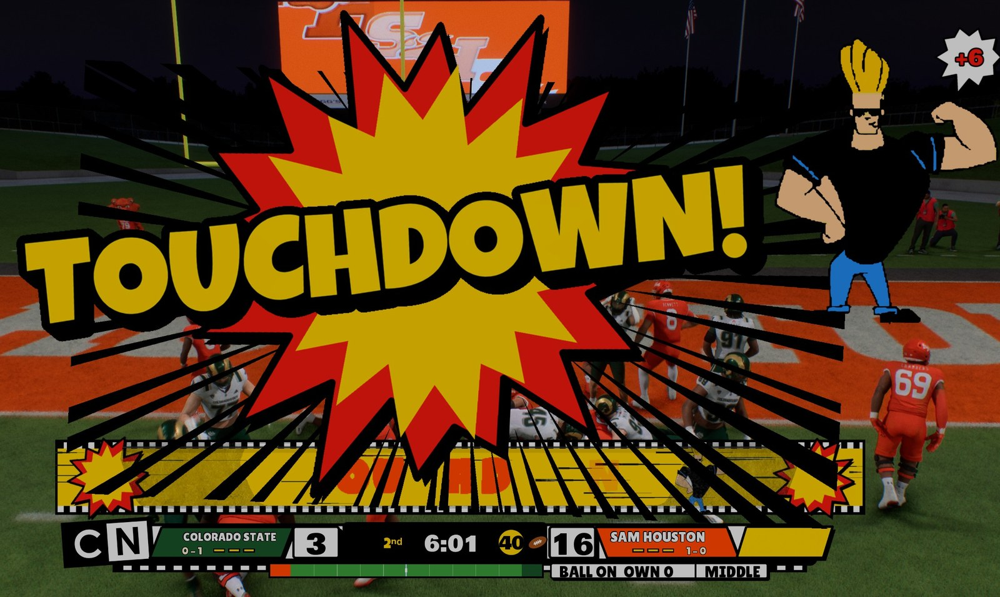
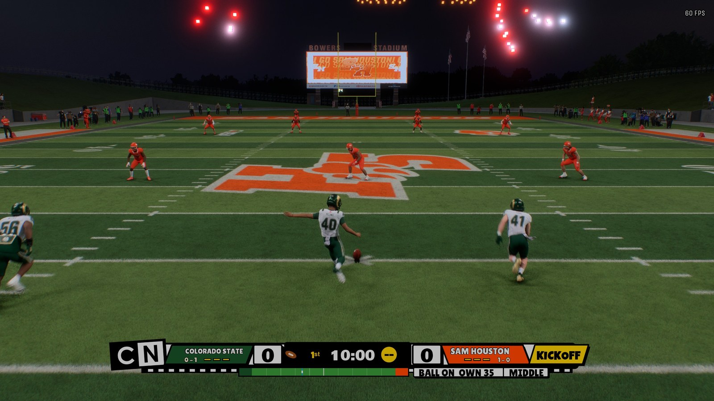
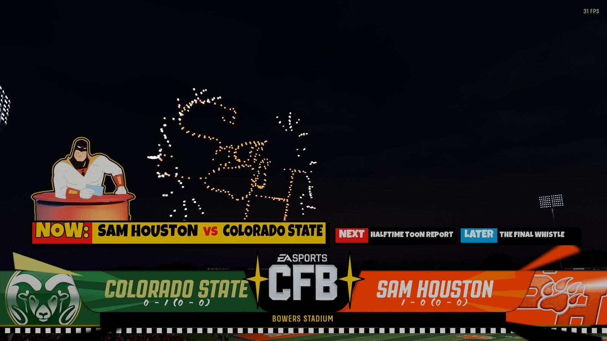
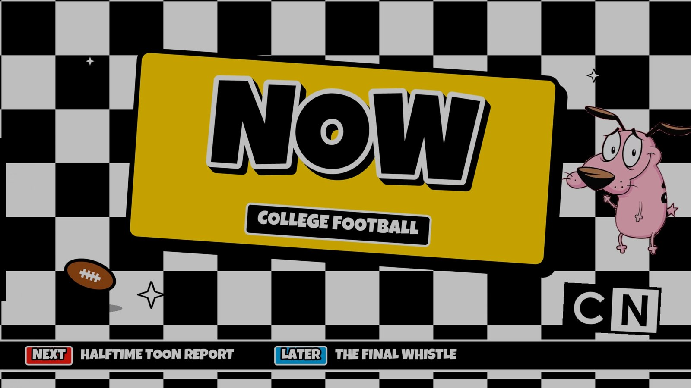
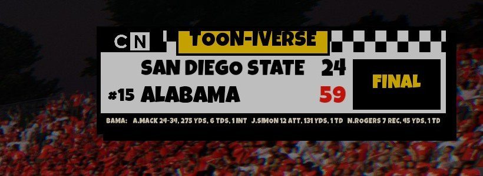
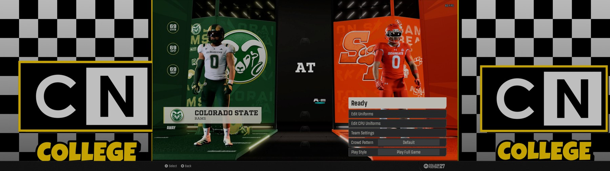

# CFB on CN

**College Football on Cartoon Network: the 1992-2004 checkerboard era as a full TV presentation for College
Football 27.**

One `.fbmod` restyles the whole broadcast: the score bug, other-game scores, the pregame screen, the loading screen,
touchdown and field goal graphics, the fonts, and the side panels on ultrawide screens.

## What's in it

- **Touchdowns:** a full-screen comic burst. Speed lines, a starburst, TOUCHDOWN! slamming in and Johnny Bravo
  sliding in to flex, then a checkerboard TOUCHDOWN strip. **Field goals:** a matching FIELD GOAL strip.
- **Score bug:** a white cel bar on a black-and-white checker rail, with team colours, ranks, records, timeouts,
  possession, the play clock and the FLAG tab. Under it, a mini field shows the ball, the line of scrimmage and the
  line to gain, with "BALL ON OWN 35 | L HASH" beside it.
- **Corner scores:** other games' scores in a "Toon-iverse" box at the top right instead of the bottom ticker
  (dynasty games).
- **Pregame:** a "NOW: AWAY VS HOME" strip with Space Ghost at his desk.
- **Halftime:** the halftime page becomes a comic-book "Around the Toon-iverse" page.
- **Loading screen:** a rolling checkerboard NOW bumper, with Courage peeking in and waving.
- **Fonts:** chunky cartoon lettering on the bug, scores and banners.
- **Ultrawide:** checkerboard CN side panels on the menus instead of the team colour.

| | |
|---|---|
|  |  |
|  |  |

## Install

1. In the Mod Manager, import `CFBonCN.fbmod`.
2. Turn off any other score bug or broadcast package (NBC, ESPN, CFP ESPN and similar), and any Hide Scorebug mod.
   They replace the same screens.
3. Apply and launch.

## Coming later

- A second score bug: a corner box at the bottom right.
- A host on the halftime page.
- CN music for the pregame, quarter breaks and halftime.
